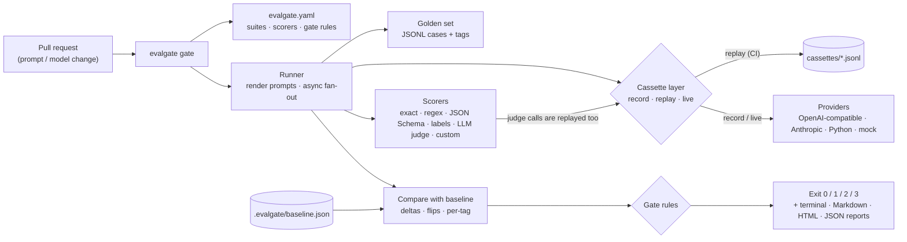

# EvalGate

**A regression gate for LLM features.** EvalGate runs golden-set evaluations against a prompt + model, compares the results to a stored baseline, and fails CI when quality drops. Unit tests, but for LLM behaviour.

[](https://github.com/mourya-dasgupta/evalgate/actions/workflows/ci.yml)
[](#testing--evals)
[](LICENSE)
[](pyproject.toml)

## The problem

Teams shipping LLM features change prompts, models and retrieval settings constantly, and nobody knows whether a change made things worse until users complain. Evals exist, but they run ad hoc in notebooks instead of being enforced in CI. EvalGate turns "did this PR make the AI worse?" into a red/green check on every pull request, deterministic and without API keys in CI.

## Demo

The bundled example ([`examples/support-triage`](examples/support-triage)) triages Indian D2C/SaaS support messages (English, Hinglish, Bengali in Latin script) into strict JSON. A teammate "simplifies" the prompt; `make demo` replays both versions against a 66-case golden set and the gate catches it. This is the Markdown report EvalGate produced for that pull request, as it would appear in a PR comment ([full report](docs/assets/demo-gate-fail.md), [HTML report with per-case drill-down and confusion matrices](docs/assets/demo-gate-fail.html)):

<!-- demo-excerpt:start -->
````markdown
## EvalGate: ❌ FAIL

Run `2026-11-03T07-04-00-765460Z` vs baseline `2026-11-03T07-03-59-670128Z` · mode `replay`

| Suite | Cases | Pass rate | Δ vs baseline | Score | Flips | Verdict |
|---|---:|---:|---:|---:|---:|---|
| triage | 66 | 62.1% | -27.3 pp | 0.857 | 18 | ❌ FAIL |

**triage** — gate rules

- ❌ `min_pass_rate`: pass rate 62.1% is below the floor of 80.0%
- ❌ `max_regression`: pass rate moved -27.3 pp vs baseline (allowed drop: 5 pp)
- ❌ `max_new_failures`: 18 case(s) flipped from pass to fail (allowed: 3)
- ❌ `critical_tags`: critical case(s) failing: t011, t012, t013, t015, t054

▼ 18 flipped case(s) (collapsed in the PR comment); the first one:

#### `t011` · tags: polite-urgent, critical

**Input**

```json
{
  "message": "Hello team, hope you're well. I noticed ₹2,350 was debited twice from my HDFC account for order #77812. Could you please look into it when you get a chance? Thank you!"
}
```

**Expected**

```json
{
  "category": "billing",
  "priority": "urgent",
  "language": "english"
}
```

**Actual**

```
{
  "category": "billing",
  "priority": "high",
  "language": "english",
  "summary": "Billing issue: Hello team, hope you're well. I noticed ₹2,350 was debited twice from my HDFC account for order #77812. Could"
}
```

**Why it fails:** `label_match:priority: expected 'urgent', predicted 'high'`

… 17 more flipped case(s) …

▼ Pass rate by tag

| Tag | Cases | Pass rate | Δ vs baseline |
|---|---:|---:|---:|
| `angry-low` | 6 | 0.0% | -100.0 pp |
| `b2b` | 3 | 66.7% | -33.3 pp |
| `bengali` | 9 | 66.7% | -33.3 pp |
| `critical` | 11 | 54.5% | -45.5 pp |
| `hinglish` | 16 | 68.8% | -18.8 pp |
| `injection` | 8 | 0.0% | -87.5 pp |
| `multi-issue` | 7 | 85.7% | ±0.0 pp |
| `polite-urgent` | 5 | 0.0% | -100.0 pp |
| `sarcasm` | 6 | 50.0% | ±0.0 pp |
| `security` | 3 | 66.7% | -33.3 pp |

**Verdict: ❌ FAIL** — 1 of 1 suite(s) failed the gate: triage.
````
<!-- demo-excerpt:end -->

> [!NOTE]
> The demo's model is a **deterministic simulated model** (`examples/support-triage/sim_model.py`), not a real LLM, so it runs offline in CI. The numbers show EvalGate's mechanics, not any real model's quality. [Re-record with a real model](examples/support-triage/README.md#re-recording-with-a-real-model) for genuine numbers.

<!-- DEMO GIF PLACEHOLDER: record `make demo` (about 30 s) and embed it here, e.g.  -->
**[Demo GIF placeholder: a recording of `make demo` will go here.]**

```bash
git clone https://github.com/mourya-dasgupta/evalgate.git && cd evalgate
pip install -e . && make demo        # v1 → baseline → v2 FAILS → v1 PASSES, offline
```

## Architecture



More detail, including the data flow of one `gate` run and the cassette hashing scheme: [docs/architecture.md](docs/architecture.md).

## Quickstart

```bash
pip install "git+https://github.com/mourya-dasgupta/evalgate.git"
evalgate init              # evalgate.yaml, a 10-case golden set, a prompt, a GitHub workflow
evalgate gate              # first run: NO_BASELINE (passes with a warning)
evalgate baseline update   # promote that run to the baseline (commit .evalgate/baseline.json)
evalgate gate              # PASS, now gated against the baseline
```

The starter uses the deterministic `mock` provider, so it runs offline. Point `target` at a real model and record once with `evalgate --mode record run` (see the [guide](docs/guide.md#recording-with-a-real-model)).

## Using it in GitHub Actions

```yaml
# .github/workflows/evalgate.yml
name: EvalGate
on: [pull_request]
permissions:
  contents: read
jobs:
  evalgate:
    runs-on: ubuntu-latest
    steps:
      - uses: actions/checkout@v4
      - uses: mourya-dasgupta/evalgate@main   # pin to a release tag once published
        with:
          config: evalgate.yaml
```

The action runs `evalgate gate` in replay mode (no API keys), writes the Markdown report to the job summary, uploads the HTML report as an artifact, and fails the job when the gate fails. [`evalgate-example.yml`](.github/workflows/evalgate-example.yml) also posts the report as a sticky PR comment.

## Configuration

```yaml
suites:
  - name: triage
    target:
      provider: openai_compatible        # mock | openai_compatible | anthropic | python
      model: gpt-4o-mini
      prompt: prompts/${PROMPT_VERSION:-v1}.txt
      params: {temperature: 0}
    golden: golden/triage.jsonl          # {"id", "input", "expected", "tags", "notes"} per line
    scorers:
      - type: json_schema
        schema_path: schemas/triage.schema.json
      - type: label_match
        field: priority
        weight: 2
      - type: llm_judge
        field: summary
        required: false
        rubric: One English sentence stating the customer's actual problem.
        judge: {provider: anthropic, model: claude-haiku-5-5}
    gate:
      min_pass_rate: 0.80      # absolute floor
      max_regression: 5        # max drop vs baseline, percentage points
      max_new_failures: 3      # cases that passed before and fail now
      critical_tags: [critical]
```

Exit codes: `0` pass (or NO_BASELINE), `1` gate failed, `2` config/usage error, `3` provider/cassette error. Every field, scorer and command is documented in the [user guide](docs/guide.md#configuration-reference).

## Design decisions

- **Cassettes instead of live calls in CI.** Responses are recorded once and replayed, so CI is deterministic, fast and keyless. The trade-off is that replay cannot notice a provider silently changing a model; that is what a scheduled `--mode live` job is for. ([ADR 0001](docs/decisions/0001-cassettes-for-determinism.md))
- **The cassette key hashes the rendered prompt.** Any prompt, model or param change is a loud cache miss (exit 3) rather than a stale answer. You pay for re-recording on every prompt change, and in return the cassette diff shows exactly which answers changed. ([ADR 0002](docs/decisions/0002-cassette-key-hashes-rendered-request.md))
- **No database.** Config, golden sets, cassettes and the baseline are files in git, so a baseline change is a reviewed diff and a rollback is `git checkout`. There is no trend dashboard; history lives in git. ([ADR 0003](docs/decisions/0003-no-database-files-in-git.md))
- **Exit codes are a contract.** "The model got worse" (1), "your config is wrong" (2) and "the provider/cassette failed" (3) need different responses, and CI only sees the code. ([ADR 0004](docs/decisions/0004-exit-codes-are-a-contract.md))
- **Pluggable scorers with validated options.** A registry of built-ins plus dotted-path custom scorers; every scorer returns a score and a reason, so failures explain themselves. ([ADR 0005](docs/decisions/0005-pluggable-scorer-registry.md))
- **The LLM judge replays too.** Judge calls go through the same provider + cassette layer, so judge-based scores are as deterministic in CI as exact matches. Judge *reliability* still has to be measured against human labels. ([ADR 0006](docs/decisions/0006-llm-judge-through-provider-and-cassette.md))

All decisions: [docs/decisions/](docs/decisions/).

## Testing & Evals

<!-- numbers:start -->
- **Tests:** 172 tests (unit, provider tests with mocked HTTP via `respx`, CLI tests for every command and exit code, a Markdown snapshot test, an HTML self-containment test, and an end-to-end test of the demo story), all passing.
- **Coverage:** 99% line coverage of `src/` (CI enforces at least 90%).
- **Static checks:** `ruff check`, `ruff format --check` and `mypy --strict` pass.
- **Demo:** `make demo` runs the full story in about 2 seconds.

Demo results (66 cases, **simulated model**), prompt v1 vs the "simplified" v2:

| Slice | Cases | v1 pass rate | v2 pass rate | Δ |
|---|---:|---:|---:|---:|
| **All cases** | 66 | 59/66 (89.4%) | 41/66 (62.1%) | -27.3 pp |
| `critical` | 11 | 11/11 (100.0%) | 6/11 (54.5%) | -45.5 pp |
| `polite-urgent` | 5 | 5/5 (100.0%) | 0/5 (0.0%) | -100.0 pp |
| `angry-low` | 6 | 6/6 (100.0%) | 0/6 (0.0%) | -100.0 pp |
| `injection` | 8 | 7/8 (87.5%) | 0/8 (0.0%) | -87.5 pp |
| `hinglish` | 16 | 14/16 (87.5%) | 11/16 (68.8%) | -18.8 pp |
| `bengali` | 9 | 9/9 (100.0%) | 6/9 (66.7%) | -33.3 pp |
| `multi-issue` | 7 | 6/7 (85.7%) | 6/7 (85.7%) | +0.0 pp |
| `sarcasm` | 6 | 3/6 (50.0%) | 3/6 (50.0%) | +0.0 pp |
| `security` | 3 | 3/3 (100.0%) | 2/3 (66.7%) | -33.3 pp |
| `b2b` | 3 | 3/3 (100.0%) | 2/3 (66.7%) | -33.3 pp |

Priority accuracy drops from 90.9% (v1) to 63.6% (v2); category accuracy from 97.0% to 90.9%. The gate fails on all four rules: pass rate below the 80% floor, a 27.3 pp regression (5 pp allowed), 18 flipped cases (3 allowed), and 5 failing `critical` cases.
<!-- numbers:end -->

Reproduce: `make cov` for tests and coverage, `make demo` for the demo table's source runs.

## Limitations

- **The bundled demo uses a simulated model.** Its numbers demonstrate the gate, not any real LLM. The same author wrote the golden set and the simulator, so its accuracy says nothing about task difficulty.
- **Replay measures recorded behaviour.** Provider-side model drift is invisible until you re-record or run `--mode live` on a schedule.
- **Pass rate is coarse on small sets.** One case in 66 is 1.5 pp; there is no statistical significance testing yet (on the roadmap).
- **Single-turn only.** No multi-turn conversations or agent trajectories yet; a `python` provider can wrap a pipeline, but only the final text is scored.
- **No cost or latency gating yet.** Usage and latency are recorded in cassettes but not reported or gated.
- **Golden-set edits blur deltas.** When cases are added or removed, the delta compares different case sets (EvalGate warns about it).
- **The Docker image was not built in the development environment** (no Docker daemon was available). The Dockerfile's build stage was verified by building the wheel from the same files.

Non-goals for v1: no hosted dashboard, no database, no dataset-labelling UI, no tracing/observability, no fine-tuning.

## Roadmap

Statistical significance for noisy evals, cost and latency tracking, a PR-comment bot, RAG and agent-trajectory scorers, a pytest plugin, a static trend dashboard and an MCP server. See [docs/roadmap.md](docs/roadmap.md).

## More docs

[User guide](docs/guide.md) · [Architecture](docs/architecture.md) · [Runbook](docs/runbook.md) · [Roadmap](docs/roadmap.md) · [Decisions](docs/decisions/) · [Changelog](CHANGELOG.md) · [Contributing](CONTRIBUTING.md)

## License

[MIT](LICENSE) © 2026 Mourya
