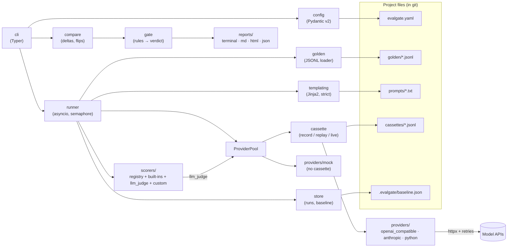
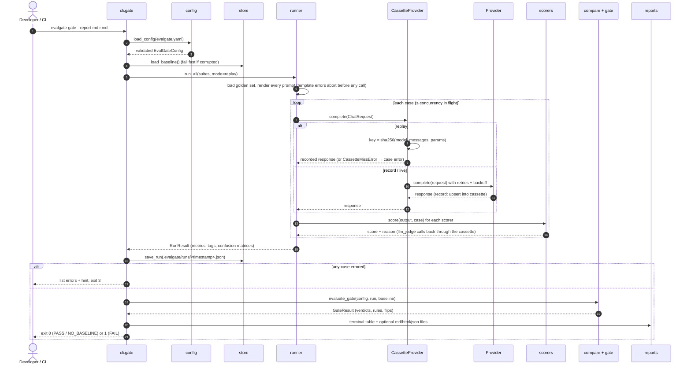

# Architecture

EvalGate is a small Python package with clear module boundaries and no services. Everything
it reads and writes is a file.

## Components



| Module | Responsibility |
|---|---|
| `config` | Pydantic v2 models for `evalgate.yaml`, `${VAR:-default}` interpolation, located error messages, path resolution relative to the config file. |
| `golden` | JSONL golden-set parsing with every error reported by line number. |
| `templating` | Jinja2 prompt templates with `StrictUndefined`. |
| `providers/` | The `Provider` interface (`async complete(ChatRequest) -> ChatResponse`) and implementations: `mock`, `openai_compatible`, `anthropic`, `python`. Shared HTTP plumbing handles keys, timeouts and retries. |
| `cassette` | `Cassette` (JSONL store) and `CassetteProvider`, which wraps any provider with record/replay/live behaviour. |
| `scorers/` | The scorer registry, built-in scorers, `llm_judge`, custom dotted-path scorers, and `build_scorers`, which validates options. |
| `runner` | Renders prompts, fans out calls with a concurrency limit, scores outputs, aggregates metrics, per-tag stats and confusion matrices. |
| `results` | Pydantic models for runs (the baseline is just a promoted run). |
| `store` | Atomic writes of runs and the baseline, loading with friendly corruption errors. |
| `compare` | Pass-rate deltas, flips, fixes, added/removed cases, per-tag deltas. |
| `gate` | Gate rules → per-suite and overall verdicts and the process exit code. |
| `reports/` | Terminal (rich), Markdown (PR comment), HTML (self-contained, Jinja2), JSON. |
| `validate` | Static checks used by `evalgate validate`. |
| `cli` | Typer commands, global flags, error-to-exit-code mapping. |

## Data flow of one `gate` run



## Cassette hashing scheme

For every model call (target or judge) the runner builds a provider-agnostic request:

```python
ChatRequest(
    model="gpt-4o-mini",
    messages=({"role": "system", "content": "..."}, {"role": "user", "content": "<rendered prompt>"}),
    params={"temperature": 0, "max_tokens": 300},
)
```

The key is:

```
sha256( json.dumps({"v": 1, "model": ..., "messages": [...], "params": {...}},
                   sort_keys=True, separators=(",", ":"), ensure_ascii=False).encode("utf-8") )
```

Properties:

- **Rendered, not templated.** The hash covers the final text sent to the model, so a change to
  the template *or* to a case's input changes the key.
- **Canonical.** Sorted keys and fixed separators make it independent of dict ordering
  (`{"a": 1, "b": 2}` and `{"b": 2, "a": 1}` hash the same).
- **Provider-agnostic.** The provider kind and base URL are excluded; the model name is included.
- **Versioned.** `"v": 1` lets the scheme change without accidentally matching old entries.

Each cassette line stores the key, the provider name, the canonical request (for humans and
diffs), the response text and usage, and the recorded latency. Lines are sorted by key so
re-recording produces minimal git diffs, and recording the demo twice is byte-identical.

A miss in replay mode raises `CassetteMissError`. The runner records it as a case error,
the CLI refuses to gate on a partial run, and exits 3 with the re-record command.

## Extension points

| Extension | How |
|---|---|
| **Custom scorer (function)** | `type: custom`, `path: my_module:fn`; `fn(output, case[, options])` returns `ScoreResult`/float/bool/`(score, reason)`, sync or async. |
| **Custom scorer (class)** | Subclass `evalgate.scorers.Scorer` with an `Options` Pydantic model; reference it with `type: custom, path: my_module:MyScorer, options: {...}`. Or register it under a new type name with `@register_scorer("name")` when used as a library. |
| **Custom provider / whole pipeline** | `provider: python`, `entrypoint: my_module:MyPipeline`, an object with `complete(request)` returning text. Cassetted like any provider, so a RAG pipeline or tool-using agent can be recorded and replayed as a black box. |
| **New HTTP provider** | Subclass `HTTPProvider` (retries, timeouts, keys come for free), implement `complete`, and add it to `create_provider`. |
| **Reports** | `evalgate report --format json` (or `--report-json`) is the stable machine-readable surface for dashboards and bots. |
| **Library use** | `load_config` → `run_sync` → `evaluate_gate` → `render(...)` are plain functions. |

## Design constraints

- **Deterministic CI, no keys**: replay is the default mode; see [ADR 0001](decisions/0001-cassettes-for-determinism.md).
- **Friendly errors**: every user-caused error is an `EvalGateError` subclass carrying a
  message, an optional hint and an exit code; see [ADR 0004](decisions/0004-exit-codes-are-a-contract.md).
- **Small dependency set**: typer, pydantic, pyyaml, httpx, rich, jinja2, jsonschema.
- **Typed**: `mypy --strict` passes on `src/`.
